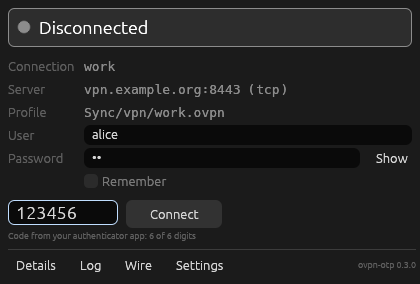
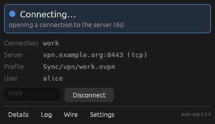
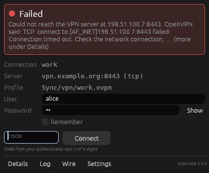
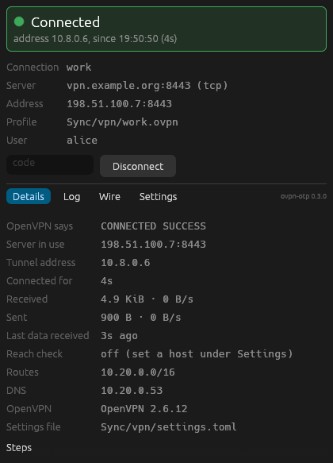
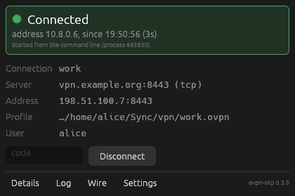
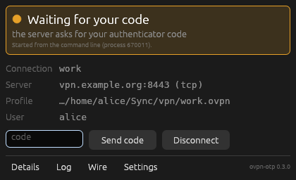
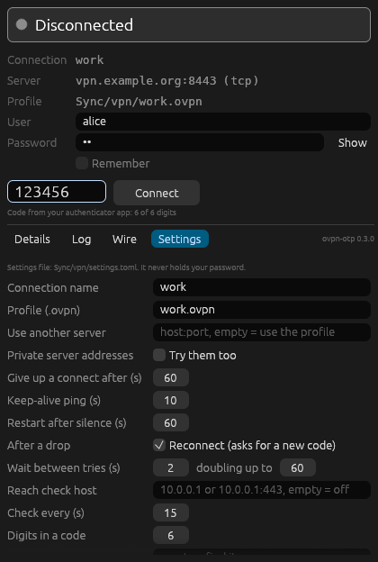

# ovpn-otp

ovpn-otp connects you to an OpenVPN server that wants your 6-digit authenticator code typed after your password, and it gives that code its own box so you can see what you typed.

It works with Sophos Firewall SSL VPN and with any other OpenVPN server that expects the code appended to the password. It runs on Windows and Linux, as a small desktop window (`ovpn-otp-gui`) and as a command-line tool (`ovpn-otp`) for scripts and agents.


> [!NOTE]
> ovpn-otp is an independent open-source project. It is not affiliated with, endorsed by or connected to Sophos or OpenVPN Inc. It uses the free OpenVPN community program to make the actual connection.

## Why

Many firewall VPNs ask for "password followed by your 2FA code" in one masked password box. You type `mypassword123456`, see only dots, and when the login fails you cannot tell whether the password or the code was wrong. ovpn-otp fixes that, and adds a few things the usual clients leave out:

- **Saved login.** Your user name and password are kept in the credential store of your operating system (Windows Credential Manager, or the desktop keyring on Linux), never in a file.
- **A separate, visible code box.** You type the 6 digits on their own, in plain sight, and ovpn-otp appends them to the password for you.
- **Know what you are connected to.** The window and `ovpn-otp status` always show the profile file, the server with the port and protocol, the name of the connection, your user name, and the state in colour and in words: Connected, Connecting…, Disconnected or Failed.
- **See what is going on.** A live timeline of the connection steps, bytes in and out with the current speed, how long ago data last arrived, your tunnel address, the routes and DNS servers the server sent, an optional check that a host behind the VPN answers (with the round-trip time), a full log with a level filter, and the complete conversation with OpenVPN, with secrets hidden.
- **Keep-alive and reconnect.** Keep-alive pings detect a dead link, and ovpn-otp reconnects by itself with a growing wait between tries. Because the server wants a fresh code after a real drop, ovpn-otp asks you for one.
- **A reason when a connect fails.** ovpn-otp tells you whether the server rejected the login, closed the connection without a word, shares no cipher with OpenVPN, or could not be reached. It does not keep asking for code after code while the real problem is somewhere else, and a connect that makes no progress ends by itself with the step it was stuck in.
- **Made for scripts and AI agents too.** Everything the window does and every setting is a command, with JSON output and an exit code for each outcome.
- **One settings file for all your machines.** The settings hold no secrets, so you can keep them in a synced folder or a private git repository and use the same file on your Windows PC and your Linux laptop.

## How it works

ovpn-otp does not implement the VPN itself. It starts the standard `openvpn` program and steers it through the OpenVPN management interface, a text channel on `127.0.0.1` that OpenVPN offers for exactly this purpose. When the server asks for a login, OpenVPN asks ovpn-otp, and ovpn-otp answers with your saved user name and `password + code`.

```
 you ── ovpn-otp window or CLI ──(management interface, 127.0.0.1)── openvpn ──(VPN)── server
```

Because the real work is done by OpenVPN, your connection is exactly as secure and compatible as it is with any other OpenVPN client.

## Install

### Windows

1. Install the **OpenVPN community client**, version 2.6 or newer, from <https://openvpn.net/community-downloads/> with the default options. The defaults include the "OpenVPN Interactive Service", which lets ovpn-otp start OpenVPN without admin rights. (OpenVPN Connect, the other OpenVPN app, cannot be used: it has no way for another program to drive it.)
2. Make sure your Windows user is in the **OpenVPN Administrators** group. The installer adds the user who ran it; to add another user, open *Computer Management → Local Users and Groups → Groups → OpenVPN Administrators*, add the user, then sign out and in again. Members of this group may run their own VPN profiles through the service.
3. Download `ovpn-otp-<version>-x86_64-pc-windows-msvc.zip` from the [releases page](https://github.com/kiatng/ovpn-otp/releases), unzip it anywhere, and start `ovpn-otp-gui.exe`.

> [!TIP]
> ovpn-otp can also run an `openvpn.exe` (2.6 or newer) that came with another program. Point `openvpn.windows.path` at it and set `openvpn.windows.launch` to `"direct"`. OpenVPN then needs admin rights to create the tunnel, so start ovpn-otp from an administrator window.

### Linux (Arch, Omarchy, Debian, Ubuntu, ...)

1. Install OpenVPN with your package manager:

   ```sh
   sudo pacman -S openvpn        # Arch, Omarchy
   sudo apt install openvpn      # Debian, Ubuntu
   ```

2. Download `ovpn-otp-<version>-x86_64-unknown-linux-gnu.tar.gz` from the [releases page](https://github.com/kiatng/ovpn-otp/releases) and put the two programs on your path:

   ```sh
   tar xzf ovpn-otp-*-x86_64-unknown-linux-gnu.tar.gz
   install -m 755 ovpn-otp-*/ovpn-otp ovpn-otp-*/ovpn-otp-gui ~/.local/bin/
   ```

3. Give OpenVPN the right to create the tunnel, as described in [Linux: let openvpn create the tunnel](#linux-let-openvpn-create-the-tunnel). **Do not run the window itself as root**; only OpenVPN needs the extra rights.

To build from source instead, install Rust and run `cargo build --release`; the programs land in `target/release/`.

## First connect

You need your VPN profile, a `.ovpn` file. On a Sophos Firewall you download it from the user portal, in the SSL VPN section; other servers have a similar download. If you already imported it into another client, download it again, because ovpn-otp needs the file itself.

1. Put the profile somewhere you like, for example next to your settings file.
2. Start `ovpn-otp-gui`. It opens with **Settings** open because there is no profile yet. Enter the path to the `.ovpn` file in **Profile (.ovpn)** and click **Save settings**. The **Server** and **Profile** rows at the top now show what you will connect to.
3. Enter your user name and password in the **User** and **Password** rows. Leave **Remember** ticked to keep them in the credential store.
4. Open your authenticator app, type the 6-digit code into the code box, and press Enter or click **Connect**.

Notice what you did **not** have to do: you never glued the code onto the password, and next time you only type the code.

From the command line the same steps look like this:

```sh
ovpn-otp config init --profile ~/vpn/work.ovpn --name work   # once
ovpn-otp login                                               # once: saves user name and password
ovpn-otp status                                              # the profile, server and user name in use
ovpn-otp connect                                             # asks for the code, shows each step
```

`connect` stays in the foreground and prints each connection step; press Ctrl+C to disconnect. You may now be wondering how to check on it from another terminal, or how a script gives it a code. Don't worry, [Command line](#command-line) and [Using it from scripts and AI agents](#using-it-from-scripts-and-ai-agents) cover both below.

ovpn-otp never guesses your user name. It uses the one you typed, either in the window, at `ovpn-otp login`, or with `--username`.

## The window

The window is small on purpose: about 420 by 290 points, and only as tall as what it shows. The top part is always there, and it answers three questions at a glance.

**What state is the connection in?** The banner says it in colour and in words:

| Banner | Colour | What it adds |
| --- | --- | --- |
| **Connected** | green | Your address inside the VPN, and since when. |
| **Connecting…** | blue | The step OpenVPN is at ("opening a connection to the server", "logging in", ...) and for how long. |
| **Waiting for your code** | amber | Why a code is needed. |
| **Reconnecting…** | amber | When the next try starts. |
| **Disconnected** | grey | Why, when a connection dropped. |
| **Failed** | red | The reason, in a sentence. |

| | |
| --- | --- |
|  |  |
|  |  |

**What am I connecting to?** Below the banner, four rows that never go away: **Connection** (the name in the settings), **Server** (host, port and protocol from the profile), **Profile** (the `.ovpn` file in use) and **User**. While a session runs, an **Address** row shows the address OpenVPN is talking to, when the profile names the server another way.

**What do I do next?** The code box and one button: **Connect**, or **Disconnect** while a session runs. The code box takes digits only and counts them ("4 of 6 digits"), so a short or mistyped code is caught before it reaches the server. With a saved login the **User** row shows only your user name, with **Change** next to it; the password box comes back when you click that.

Everything else is one click away, on the line at the bottom. A click opens the part and makes the window taller; a second click closes it again.

| Part | What it shows |
| --- | --- |
| Details | The state OpenVPN itself reports, the server in use, your tunnel address, how long the connection has been up, bytes received and sent with the speed, how long ago data last arrived (a number that keeps growing means the link has gone quiet), the reach check, routes and DNS, and every step of the connection with the time it happened. The full reason for a failure is here too. |
| Log | The OpenVPN log and messages from ovpn-otp, with a filter for warnings and errors. |
| Wire | Every line exchanged with OpenVPN on the management interface. Passwords, codes and session tokens show as `********`. |
| Settings | The settings for this machine, and **Copy diagnostics**, which puts a troubleshooting report on the clipboard: versions, status, settings, timeline, log and wire transcript. Your password never appears in it, and your user name is replaced with `<user>`. |

The window also shows a session that `ovpn-otp connect` started in a terminal. The banner then says "Started from the command line", and **Disconnect** and the code box work on that session.



## Keep-alive and reconnect

Two settings make OpenVPN notice a dead link: it sends a keep-alive **ping** every 10 seconds, and when nothing arrives for 60 seconds it **restarts** the connection. Some servers send their own values, which then take priority.

When a connection drops, ovpn-otp waits a little and tries again: first 2 seconds, then 4, 8 and so on, up to 60 seconds. The server needs a fresh code for the new login, so the window comes to the front, and the banner turns amber and says "Waiting for your code". In the terminal, `connect` prints a prompt; type the code and press Enter. From another terminal or a script, `ovpn-otp code` gives the code to the waiting session. A code that is more than 90 seconds old is not used, because the server would reject it.



ovpn-otp never stores or generates your authenticator secret. The code always comes from your authenticator app.

> [!TIP]
> Untick **Reconnect** under Settings (or run `ovpn-otp config set keepalive.auto_reconnect false`) if you would rather have ovpn-otp stop after a drop.

## Sharing settings between machines

Everything except your login lives in one settings file, `settings.toml`. ovpn-otp looks for it in this order:

1. the `--config FILE` option (for the window: `ovpn-otp-gui FILE`);
2. the `OVPN_OTP_CONFIG` environment variable;
3. the default place: `%APPDATA%\ovpn-otp\config\settings.toml` on Windows, `~/.config/ovpn-otp/settings.toml` on Linux.

Run `ovpn-otp config path` to see which file is in use.

To share the settings, put `settings.toml` and your `.ovpn` profile together in a folder that both machines see, such as a synced folder (Syncthing, OneDrive, Dropbox) or a **private** git repository. Write the profile path relative to the settings file (`path = "work.ovpn"`), so it works on both machines. Then point each machine at the file:

```powershell
# Windows (PowerShell), once:
[Environment]::SetEnvironmentVariable("OVPN_OTP_CONFIG", "$env:USERPROFILE\Sync\vpn\settings.toml", "User")
```

```sh
# Linux, in ~/.bashrc or ~/.profile:
export OVPN_OTP_CONFIG=~/Sync/vpn/settings.toml
```

On each machine you save the login once (`ovpn-otp login`, or tick **Remember** in the window), because the credential store is per machine. Settings that differ between Windows and Linux, such as where `openvpn` is, live in their own `[openvpn.windows]` and `[openvpn.linux]` sections, so one file serves both.

> [!WARNING]
> The `.ovpn` profile contains the certificate for your VPN and sometimes a private key. Share it only through a private folder or repository, never a public one.

## Settings



Every option, with its default. The same list, with comments, is in [`examples/settings.toml`](examples/settings.toml). You can change each one in the window under **Settings**, in the file, or by name with `ovpn-otp config set`, as [Change settings from the command line](#change-settings-from-the-command-line) shows.

| Option | Default | What it does |
| --- | --- | --- |
| `name` | `"default"` | A short name for the connection. The saved login is stored under this name. |
| `profile.path` | | Path to the `.ovpn` profile, relative to the settings file. |
| `profile.inline` | | The profile text itself, instead of `path`. |
| `profile.remote` | | `host:port` to use instead of the `remote` line in the profile. |
| `profile.allow_private_remotes` | `false` | Also try server addresses inside a private network, such as `10.255.0.1`, when the profile has a public address too. See [What ovpn-otp changes in your profile](#what-ovpn-otp-changes-in-your-profile). |
| `keepalive.ping` | `10` | Seconds between keep-alive pings. 0 uses the profile's value. |
| `keepalive.ping_restart` | `60` | Seconds without anything from the server before OpenVPN restarts the connection. 0 uses the profile's value. |
| `keepalive.auto_reconnect` | `true` | Reconnect by itself after a drop (asks for a new code). |
| `keepalive.backoff_initial` | `2` | Seconds to wait before the first reconnect try. Doubles on each try. |
| `keepalive.backoff_max` | `60` | Longest wait between tries, in seconds. |
| `check.host` | | A host behind the VPN to check while connected: `10.0.0.1` uses ping, `10.0.0.1:443` opens a TCP connection. Empty turns the check off. |
| `check.interval` | `15` | Seconds between checks. |
| `code.digits` | `6` | Digits in your code. 0 accepts any length. |
| `connect.timeout` | `60` | Seconds a connect may go without progress before ovpn-otp ends it and says where it stuck. OpenVPN gets the same number, so it also gives up a server that does not answer after this long. 0 waits as long as OpenVPN does. |
| `openvpn.extra_options` | `[]` | Extra OpenVPN options added after the profile, such as `"mute 10"`. See [Extra OpenVPN options](#extra-openvpn-options) for the two ways to write them. |
| `openvpn.verb` | `3` | How much OpenVPN logs, from 0 (nothing) to 11. 4 and up help when you look for a problem. A `verb` in `extra_options` wins over this setting. |
| `openvpn.windows.path` | found automatically | Where `openvpn.exe` is. |
| `openvpn.windows.launch` | `"auto"` | `"service"` starts OpenVPN through the interactive service (no admin rights), `"direct"` runs `openvpn.exe` yourself (needs an admin window), `"auto"` uses the service when it is running. |
| `openvpn.linux.path` | found automatically | Where `openvpn` is. |
| `openvpn.linux.command_prefix` | `["sudo", "-n"]` | The command that gives OpenVPN network rights, put in front of `openvpn`. `[]` when it already has them. |

### What ovpn-otp changes in your profile

Before OpenVPN starts, ovpn-otp makes a private copy of your profile with a few changes. Your own `.ovpn` file is never changed, and the copy is deleted when the session ends.

- **The login comes from ovpn-otp.** `auth-nocache` is added too, so that OpenVPN asks for a fresh login after a drop.
- **Your keep-alive values** are added at the end, where they take priority over the values in the profile.
- **The time to wait for a server** (`connect-timeout`) is set to `connect.timeout` from your settings, unless the profile or `extra_options` already says how long to wait.
- **An old cipher line is made to work.** Many firewall profiles name the cipher with a line such as `cipher AES-128-CBC`. OpenVPN 2.6 and newer ignore that line when they agree a cipher with the server. A server that only accepts AES-128-CBC then finds nothing in common, and it ends the connection right after the secure channel is set up. So when the profile has a `cipher` line and no `data-ciphers` line, ovpn-otp adds two lines: `data-ciphers AES-256-GCM:AES-128-GCM:CHACHA20-POLY1305:AES-128-CBC` (the ciphers OpenVPN offers, plus the one from your profile) and `data-ciphers-fallback AES-128-CBC` (for servers that cannot agree a cipher at all). ovpn-otp does this for AES, Camellia, ARIA and ChaCha20 ciphers.
- **Private server addresses are skipped.** Some profiles list the server twice: by the public address, and by the address inside the office network, such as `10.255.0.1`. From outside the office the second address never answers, and OpenVPN can wait two minutes on it. When a profile has both kinds, ovpn-otp leaves out the private ones. Set `allow_private_remotes = true` under `[profile]` to try them too. A profile with only private addresses is used as it is.

The session log says so when one of the last two changes was made, and `ovpn-otp doctor` shows them before you connect.

The private addresses are `10.x.x.x`, `172.16.x.x` to `172.31.x.x`, `192.168.x.x`, `100.64.x.x` to `100.127.x.x`, `169.254.x.x`, and the IPv6 ranges `fc00::/7` and `fe80::/10`. A host name is never skipped.

> [!NOTE]
> OpenVPN can hand the encrypted traffic to the Linux or Windows kernel, which is faster. This is called data channel offload (DCO), and it works only with AES-GCM and ChaCha20 ciphers. When a CBC cipher is in the two lines above, OpenVPN turns DCO off by itself and says so in the log ("disables data channel offload"). You do not need to add `disable-dco`.

To choose the ciphers yourself, set `data-ciphers` in `extra_options`. ovpn-otp then adds neither of the two lines.

### Extra OpenVPN options

`extra_options` adds OpenVPN options after everything else, so they take priority over the profile and over the lines ovpn-otp adds. You can write them in two ways.

One option per item, written as in a `.ovpn` file:

```toml
[openvpn]
extra_options = ["data-ciphers AES-256-GCM:AES-128-CBC", "verb 4"]
```

Or as on the `openvpn` command line, each word as its own item:

```toml
[openvpn]
extra_options = ["--data-ciphers", "AES-256-GCM:AES-128-CBC", "--verb", "4"]
```

Both give OpenVPN the same two options, `data-ciphers AES-256-GCM:AES-128-CBC` and `verb 4`. In the second way, an item that starts with `--` starts an option, and the items after it are the parameters for that option.

`verb` is the one option that ovpn-otp does not write into the profile copy. Because OpenVPN takes the log level from the command line it was started with, ovpn-otp puts the level there, once: from a `verb` in `extra_options` when there is one, or else from `openvpn.verb`, or else 3.

**Do not put an item without `--` before the first item with `--`**, because nothing says which option it belongs to. ovpn-otp then does not connect, and it names the item: `extra_options item 1 ("verb 4") comes before the first item that starts with "--".` Run `ovpn-otp doctor` to check the format and to see the lines OpenVPN will get.

## Command line

`ovpn-otp` does everything the window does, and reaches every setting. A session started by the window can also be checked and stopped from the command line, and the other way round.

| Command | What it does |
| --- | --- |
| `ovpn-otp connect` | Connect and stay connected until Ctrl+C. Asks for the code, or takes it with `--code-stdin` or `--code 123456`. With `--background` it starts the session as its own process and returns when the tunnel is up or the connect has failed. |
| `ovpn-otp disconnect` | Stop the running session. |
| `ovpn-otp reconnect` | Stop the running session, if there is one, and connect again. Takes the same options as `connect`. |
| `ovpn-otp status` | Show the state, and the profile, server and user name in use. While a session runs, also the address, traffic, last data, check and routes. |
| `ovpn-otp code` | Give a code to a session that is waiting for one: `ovpn-otp code --stdin`, or `ovpn-otp code 123456`. |
| `ovpn-otp wait` | Wait until the session is connected or gone: `--until connected` or `--until disconnected`, with `--timeout SECONDS` (60 when left out). |
| `ovpn-otp logs` | Print the session log. `-f` keeps following it, `--wire` adds the management transcript, `-n 50` shows the last 50 lines, `--level warning` shows only warnings and errors. |
| `ovpn-otp profile show` / `set FILE` / `list` | Show the profile in use and the servers in it, use another `.ovpn` file, or list the `.ovpn` files next to the settings file and in the folder where OpenVPN keeps profiles. |
| `ovpn-otp config show` / `get KEY` / `set KEY VALUE` / `unset KEY` / `keys` / `path` / `edit` / `init` | Print the settings, read or change one by name, put one back to the default, list every setting with what it does, show where the settings file is, open it in your editor, or create it for a profile. |
| `ovpn-otp login set` / `show` / `clear` | Save the user name and password in the credential store, show the saved user name (never the password), or remove the saved login. `ovpn-otp login` alone saves, and `ovpn-otp logout` removes. |
| `ovpn-otp doctor` | Check the settings, the extra options, the profile, OpenVPN, the privileges and the saved login. |
| `ovpn-otp diagnostics` | Print the troubleshooting report, with secrets removed. |

**Every command that prints data takes `--json`**: `status`, `connect --background`, `disconnect`, `reconnect --background`, `wait`, `logs`, `profile show`, `profile list`, `config show`, `config get`, `config keys`, `login show` and `doctor`. The password and the code are never printed, with or without `--json`.

In a terminal, `connect` first says what it uses (connection, profile, server and user name), then asks you for what it needs: the login when none is saved, and the code. When the first login fails it says why and ends, except for a rejected login, where it asks you for a new code.

There is no background service: whichever program started the session (the window or `connect`) runs it, and the other commands talk to it through small files in a private folder (`$XDG_RUNTIME_DIR/ovpn-otp` on Linux, `%LOCALAPPDATA%\ovpn-otp\data\run` on Windows; `OVPN_OTP_RUNTIME_DIR` overrides it).

### What `status` prints

`status` always starts with the state and with what is in use, whether a session runs or not:

```
State:      Connected: address 10.8.0.6, since 14:02:11 (12m 3s)
Connection: work
Settings:   /home/alice/Sync/vpn/settings.toml
Profile:    /home/alice/Sync/vpn/work.ovpn
Server:     vpn.example.org:8443 (tcp), now at 203.0.113.10:8443
User:       alice
```

The first line reads `Connecting…: logging in (12s)` while a connect is under way, `Disconnected` when nothing runs, and `Failed: ` with the reason after a connect that failed. In a terminal the state word is coloured the way the banner in the window is: green, blue, amber, grey or red. Set `NO_COLOR` to turn the colour off.

Without a running session, the lines say what the next connect would use, so you can check the profile and the server before you connect.

### Change settings from the command line

A setting has the name it has in the settings file, with a dot between the section and the option: `ping` under `[keepalive]` is `keepalive.ping`. Here is how to read one, change it and put it back:

```sh
ovpn-otp config get keepalive.ping          # 10
ovpn-otp config set keepalive.ping 20
ovpn-otp config unset keepalive.ping        # back to the default
ovpn-otp config keys                        # every setting with the value and what it does
```

A list takes one word for each item, and a setting that is on or off takes `true` or `false`:

```sh
ovpn-otp config set openvpn.extra_options "mute 10" "disable-dco"
ovpn-otp config set openvpn.linux.command_prefix sudo -n
ovpn-otp config set keepalive.auto_reconnect false
```

`config set` checks the value before it saves. A name that does not exist, or a value of the wrong kind, ends with exit code 2 and a message such as ``there is no setting `ping`. Did you mean keepalive.ping?``, and the file stays as it was. `config edit` opens the file in your editor (`$VISUAL`, then `$EDITOR`) and checks it when you close the editor.

The profile and the saved login have their own commands:

```sh
ovpn-otp profile list                       # the .ovpn files found, * marks the one in use
ovpn-otp profile set ~/vpn/office.ovpn      # use this one from now on
ovpn-otp profile show                       # the file, the servers in it and what ovpn-otp changes

printf '%s\n' "$VPN_PASSWORD" | ovpn-otp login set --username "$VPN_USER" --password-stdin
ovpn-otp login show                         # the saved user name; the password is never shown
ovpn-otp login clear
```

> [!NOTE]
> A running session keeps the settings it started with. After a change, run `ovpn-otp reconnect` to use the new ones.

## Using it from scripts and AI agents

A script or an AI agent can run a whole connection without a window and without a terminal. Each command takes what it needs from options and standard input, prints JSON when asked, and ends with an exit code that names the outcome.

Here is a whole session:

```sh
# Start the session: password on the first line, code on the second.
printf '%s\n%s\n' "$VPN_PASSWORD" "$CODE" |
  ovpn-otp connect --username "$VPN_USER" --password-stdin --code-stdin --background --json
echo $?                      # 0: the tunnel is up

ovpn-otp status --json       # where things stand, at any time
ovpn-otp logs --json -n 20   # the last 20 log lines, one JSON object per line
ovpn-otp disconnect
```

Notice what the script did **not** have to do: it never watched the output for a prompt, and it never had to guess whether the connect worked. `connect --background` returned only when the tunnel was up or the connect had failed, and the exit code said which. The session itself keeps running as its own process until `ovpn-otp disconnect`.

`$VPN_USER`, `$VPN_PASSWORD` and `$CODE` stand for values that you supply. ovpn-otp never guesses a user name: it uses the one you give with `--username`, or the one you saved with `ovpn-otp login`. With a saved login, leave out `--username` and `--password-stdin` and send only the code.

> [!WARNING]
> Anything written as an option, such as the code in `--code 123456` or `ovpn-otp code 123456`, can be seen by other users of the machine in the process list while the command runs. Send the code on standard input instead, with `--code-stdin` or `ovpn-otp code --stdin`, as the examples here do. The password can only be sent on standard input.

### Exit codes

| Code | Name | What happened |
| --- | --- | --- |
| 0 | ok | The tunnel is up, or the command did what you asked. |
| 1 | failed | Something else went wrong, for example OpenVPN did not start or no session is running. |
| 2 | usage | The command line was wrong, for example a code that is not 6 digits. |
| 3 | auth_failed | The server rejected the user name, password or code. |
| 4 | server_reset, cipher_mismatch | The server closed the connection during login and gave no reason, or the server and OpenVPN have no cipher in common. |
| 5 | unreachable | No server answered. |
| 6 | needs_code | The session is waiting for an authenticator code. |
| 7 | timeout | A time limit ran out: the one given with `--timeout`, or the connect made no progress for `connect.timeout` seconds. |
| 8 | dropped | A working connection dropped and reconnecting is turned off. |

`connect --background`, `reconnect --background` and `wait` end with these codes. `connect` in the foreground ends with 0 after a normal disconnect, and with the code for the failure otherwise. `status` and `logs` end with 0 whenever they could print. The commands for settings (`config`, `profile`, `login`) end with 0 when they did what you asked, 2 when the name or the value was wrong, and 1 when something else failed, such as a profile file that is not there.

When a first connect fails, the session ends and nothing is left running, so the script can fix the cause and run `connect` again.

### When the session needs a new code

A session needs a new code when it reconnects after a drop, or when you started it without one. `connect --background` and `wait --until connected` then end with exit code 6, and the session keeps running and waits. Give it the code, then wait for the tunnel:

```sh
printf '%s\n' "$CODE" | ovpn-otp code --stdin
ovpn-otp wait --until connected --timeout 60
```

`wait --until connected` ends at once with 6 while the session waits for a code, because waiting longer would not help. `ovpn-otp code` also works on a session that the window started. A `connect` that runs in the foreground takes a new code from the next line of standard input as well.

### Timeouts

There are three timeouts, and they do different things.

- **`connect.timeout` in the settings (60 seconds)** ends a connect that makes no progress. The session stops by itself, and the reason names the step: for example "Gave up connecting to 203.0.113.10:8443 after 60 seconds without progress: the server did not answer." The exit code is 7 and `failure_reason` is `timeout`. Waiting for you to type a code does not count as no progress.
- **`connect --background --timeout 30`** gives up after 30 seconds, whatever the session is doing, **stops the session** and ends with 7. When you leave `--timeout` out, it waits 150 seconds.
- **`wait --timeout 30`** only stops waiting and ends with 7, and the session carries on.

### What `status --json` prints

Every field is always there. A field without a value is `null`.

| Field | What it holds |
| --- | --- |
| `running` | `true` while a session is running. |
| `phase` | `idle`, `starting`, `connecting`, `need_code`, `connected`, `reconnecting`, `disconnecting`, `disconnected` or `failed`. |
| `state`, `state_detail` | The state in words, as the window shows it (`Connected`, `Connecting…`, `Waiting for your code`, `Reconnecting…`, `Disconnecting…`, `Disconnected` or `Failed`), and what goes with it: the address and time, the step and time, or the reason. For people; a script should read `phase`. |
| `step` | What OpenVPN is doing while it connects, such as `logging in`. |
| `needs_code` | `true` while the session waits for a code. |
| `code_reason` | Why it needs one: `initial`, `reconnect`, `rejected`, `expired`, or `retry` (the last try to reconnect failed). |
| `failure_reason` | Why the last try failed: `auth_failed`, `server_reset`, `cipher_mismatch`, `unreachable`, `dropped`, `timeout` or `failed`. `null` once connected. |
| `last_error` | The message that goes with `failure_reason`, with the likely causes. |
| `remote` | The server in use or being tried, as `host:port`. |
| `local_ip` | The address of your machine inside the VPN. |
| `since` | When the session entered this phase. |
| `connected_since` | When the tunnel came up. |
| `bytes_in`, `bytes_out` | Bytes received and sent. |
| `openvpn_state` | The state OpenVPN itself reports, such as `CONNECTED` or `WAIT`. |
| `reconnect_attempt`, `next_retry` | How many times it has tried to reconnect, and when the next try starts. |
| `routes`, `dns` | What the server told your machine to send through the VPN. |
| `name`, `settings` | The connection name and the settings file. |
| `profile`, `servers`, `username` | The profile file in use, the servers it points at with the protocol (such as `vpn.example.org:8443 (tcp)`), and the user name of the login. A running session reports what it uses; without one, these say what the next connect would use. |
| `pid`, `updated` | The process that runs the session, and when this status was written. |

Here is what a script sees after the server closed the connection during login:

```json
{
  "running": false,
  "phase": "failed",
  "needs_code": false,
  "code_reason": null,
  "failure_reason": "server_reset",
  "last_error": "The server at 203.0.113.10:8443 closed the connection during login and gave no reason. Likely causes: the code was wrong or was already used once (wait for the next code), the password is wrong, or the server does not accept the encryption cipher that OpenVPN offered (a cipher mismatch).",
  "remote": "203.0.113.10:8443",
  "...": "the other fields"
}
```

### What `logs --json` prints

Each line is one JSON object with `at` (the time), `source`, `level` (`debug`, `info`, `warning`, `error` or `fatal`) and `message`. `source` is `openvpn` for the OpenVPN log, `app` for ovpn-otp itself, `state` for a state change, `check` for the reach check, and `wire` for the management transcript. Lines from `wire` come only with `--wire`, and they have one more field, `dir`: `in` for a line from OpenVPN, `out` for a line to it.

The password and the code are never in the status, the log or the transcript.

## Linux: let openvpn create the tunnel

Creating a VPN tunnel and its routes needs network administrator rights, so OpenVPN must run with them while ovpn-otp itself runs as you. By default ovpn-otp starts OpenVPN through `sudo -n`, where `-n` means "fail instead of asking for a password" so the window never hangs on an invisible prompt. Pick one of these three ways:

**1. Allow sudo for openvpn without a password (simplest).** Create a sudo rule for your user:

```sh
echo "$USER ALL=(root) NOPASSWD: $(command -v openvpn)" | sudo tee /etc/sudoers.d/ovpn-otp
sudo chmod 440 /etc/sudoers.d/ovpn-otp
ovpn-otp doctor          # should say "sudo: openvpn may run without a password prompt"
```

> [!WARNING]
> An OpenVPN profile can run commands, so this rule effectively gives your user account root rights without a password. On a laptop only you use, that is usually acceptable; on a shared machine, prefer option 2.

**2. Ask for your password each time (pkexec).** Set `command_prefix = ["pkexec"]` under `[openvpn.linux]`. Your desktop then shows a password dialog at every connect and reconnect.

**3. Give the openvpn program the network right itself.** This avoids root altogether:

```sh
sudo setcap cap_net_admin+ep "$(command -v openvpn)"
```

and set `command_prefix = []`. Package updates remove this setting, so run the command again after updating OpenVPN. Scripts in the profile, such as DNS update scripts, then also run without root.

**DNS on Linux.** OpenVPN 2.6 does not change your DNS servers by itself, so names behind the VPN may not resolve. If you need them, add a DNS update script through `extra_options`. For example, with the `update-systemd-resolved` script installed for systemd-resolved:

```toml
[openvpn]
extra_options = ["script-security 2", "up /etc/openvpn/update-systemd-resolved", "down /etc/openvpn/update-systemd-resolved", "down-pre"]
```

OpenVPN 2.7 and newer handle DNS through their built-in `dns-updown` script.

## Troubleshooting

Start with `ovpn-otp doctor`, which checks each piece in turn. Then open **Log** and **Wire** in the window (or run `ovpn-otp logs --wire`).

| What you see | What to do |
| --- | --- |
| "OpenVPN is not installed, or its interactive service is not running" (Windows) | Install the OpenVPN community client with its default options. In *Services*, check that "OpenVPN Interactive Service" is running. |
| "The service only runs configs from its own config folder" (Windows) | Add your user to the **OpenVPN Administrators** group, then sign out and in again. |
| "sudo wants a password" (Linux) | Follow [Linux: let openvpn create the tunnel](#linux-let-openvpn-create-the-tunnel). |
| "Cannot open TUN" or "Operation not permitted" | OpenVPN has no network rights; see the same section. |
| "Login rejected", or "The server rejected the login" | Check the code first: wait for a new code in your app and try again. If it keeps failing, re-enter your password (tick **Show** to check it) and save it again. |
| "The server ... closed the connection during login and gave no reason" | The secure channel was set up, then the server hung up without an answer. Some firewalls do this instead of saying what is wrong. Wait for the next code and try once more, because a code works only once. Then check the password. If it still fails, the cause may be the cipher: look for "cipher" in `ovpn-otp logs`, and see [What ovpn-otp changes in your profile](#what-ovpn-otp-changes-in-your-profile). |
| "The server ... and OpenVPN have no encryption cipher in common" | The server uses a cipher that OpenVPN did not offer. Add it with `extra_options`, for example `"data-ciphers AES-256-GCM:AES-128-GCM:AES-128-CBC"`, with the cipher your VPN administrator names in place of the last one. |
| "Could not reach the VPN server" | Check your network connection, then the server address and port in the profile (`ovpn-otp profile show`). The message includes what OpenVPN said, such as "Connection timed out". |
| "Gave up connecting ... without progress" | The connect stood still for `connect.timeout` seconds, and the message names the step it stood at. "The server did not answer" points at the network or the server address. For a slow server, give it more time with `ovpn-otp config set connect.timeout 120`. |
| "OpenVPN stopped answering" | OpenVPN did not reply to ovpn-otp within 10 seconds. Run `ovpn-otp logs --wire` to see the last lines, and `ovpn-otp doctor` to check which OpenVPN program is used. |
| The window stayed on "Connecting" for ever (version 0.2.0, Windows) | Update to 0.3.0 or newer. OpenVPN on Windows loses a command that arrives while it is still answering another one, and 0.2.0 sent the user name and the password in a row. See [Why commands go one at a time](#why-commands-go-one-at-a-time). |
| You are not sure which profile or server is used | `ovpn-otp status` and the top of the window show the connection, the profile file, the server with the port and protocol, and the user name. Change the profile with `ovpn-otp profile set FILE`. |
| "OpenVPN did not accept an option", or "Options error" in the log | An option in the profile or in `extra_options` is not one OpenVPN knows, or it is written the wrong way. Run `ovpn-otp doctor` and see [Extra OpenVPN options](#extra-openvpn-options). |
| Connected, but nothing behind the VPN works | Look at **Routes** under Details: the server decides what goes through the VPN. Set a **Reach check host** under Settings to see whether the VPN itself carries traffic. On Linux, see the DNS note above. |
| "Last data received" keeps growing | The link has gone quiet. OpenVPN restarts it after `ping_restart` seconds, and ovpn-otp asks you for a new code. |
| OpenVPN keeps running after ovpn-otp was force-closed | ovpn-otp stops OpenVPN when you disconnect or close the window, but a crash or a forced kill leaves it running. Stop it from Task Manager (Windows) or with `sudo pkill -f 'openvpn --config .*ovpn-otp'` (Linux), which matches only an OpenVPN started by ovpn-otp. |
| Cannot read the saved login (Linux) | ovpn-otp needs a keyring through the Secret Service, such as GNOME Keyring or KeePassXC. On a desktop without one, install `gnome-keyring`, or give your user name with `--username` and the password with `--password-stdin`. |

When you ask for help, paste the output of **Copy diagnostics** or `ovpn-otp diagnostics`. Your password is never in it, but read it through before you post it publicly: it does contain the server address and the log.

## Security and privacy

- **Your password** is kept only in the OS credential store and in memory while connecting. It is never written to a file or a log; the management transcript shows `********` instead.
- **Your code** is used once and never stored. A code given with `ovpn-otp code` passes through a file that only you can read, and the session deletes that file as soon as it has read it. A code written as an option (`--code 123456`) shows in the process list while the command runs, so prefer standard input.
- **Your authenticator secret** is never asked for, stored or used. The code always comes from your authenticator app.
- **The management interface** listens only on `127.0.0.1` and is protected by a random password that changes every time OpenVPN starts. That password reaches OpenVPN through a private file (Linux) or the interactive service (Windows), and the file is deleted when the session ends.
- **The private copy of your profile** is readable only by you and is deleted when the session ends.

## Development

The code is a Rust workspace with four crates:

- `crates/core`: the library. It holds the settings, the saved login, the profile changes, the management protocol parser, the session that logs in, watches and reconnects, and the status report with the exit codes;
- `crates/cli`: the `ovpn-otp` command;
- `crates/gui`: the `ovpn-otp-gui` window (egui);
- `crates/testkit`: a fake OpenVPN for the tests. It is not part of a release.

Here is how to run the tests:

```sh
cargo test --workspace            # unit tests, and session and command-line tests against a fake OpenVPN
tests/integration/run.sh          # a real OpenVPN server and client, Linux only
```

The fake OpenVPN plays each way a connect can go: a good login, a rejected one, a server that closes the connection during login, a server that does not answer, a server that never finishes, and a server with no cipher in common. The command-line tests run the real `ovpn-otp` program against it, as a script would, and check the exit code and the JSON for each case.

### Why commands go one at a time

ovpn-otp sends OpenVPN one management command, waits for the whole answer, and only then sends the next. This is a rule and not a matter of style, **because OpenVPN on Windows loses commands otherwise**. While OpenVPN on Windows writes the answer to a command, it looks at the management socket again. A command that arrives in that moment is put behind the one still being answered, and when OpenVPN reads the command back, it gets the old one a second time and never sees the new one.

Version 0.2.0 sent the user name and the password in a row. OpenVPN answered "user name entered" twice, never saw the password, and waited for it for ever, so the window stayed on "Connecting". The setup commands were hit the same way: `state on all` was lost, `log on all` ran twice, and the second copy of the log was read as states, which is how a state named `D` showed up.

The fake OpenVPN can read the socket the same way (`windows_reentry` in `crates/testkit`). One test sends the commands in a row and gets exactly the captured exchange back; another runs the session against it and checks that every command arrives once and the tunnel comes up. In the code, `Engine::send` in `crates/core/src/session.rs` is the only way a command reaches OpenVPN.

### Pictures of the window

The pictures in this README come from the window itself. A build with the `screenshots` feature saves a picture of the window to a file and closes, so the pictures can be made again after a change:

```sh
cargo build -p ovpn-otp-gui --features screenshots
OVPN_OTP_GUI_SCREENSHOT=window.png target/debug/ovpn-otp-gui settings.toml
```

`crates/gui/src/shot.rs` lists the other variables, such as the one that opens Details or Settings for the picture. A release build does not have this feature.

The integration test builds a throwaway certificate authority, starts an OpenVPN server whose login script accepts one test user with password + a fixed test code, and runs the library and the CLI against it. It proves connect, the state timeline, byte counts, the reach check, a server-side drop with reconnect and a fresh code, a rejected code, and disconnect. It runs inside a private network namespace, so it needs `openvpn`, `openssl` and `unshare` but no root, and it cannot touch your real network.

Two more servers in that test play the failures that are hard to see otherwise. The first accepts only the cipher AES-128-CBC, as older firewalls do. The test first shows that plain OpenVPN with a profile that says `cipher AES-128-CBC` is refused by it right after the TLS handshake, and then that ovpn-otp connects with the same profile. The second server closes the connection in the middle of the login without an answer, and the test checks that ovpn-otp ends with `server_reset` and exit code 4 instead of asking for another code.

Not done yet, and welcome as contributions: macOS support, a tray icon, and automatic updates.

## License

MIT, see [LICENSE](LICENSE).
