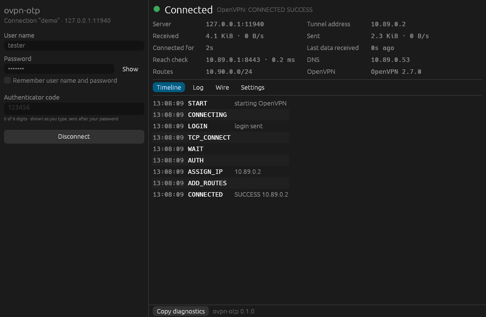

# ovpn-otp

ovpn-otp connects you to an OpenVPN server that wants your 6-digit authenticator code typed after your password, and it gives that code its own box so you can see what you typed.

It works with Sophos Firewall SSL VPN and with any other OpenVPN server that expects the code appended to the password. It runs on Windows and Linux, as a small desktop window (`ovpn-otp-gui`) and as a command-line tool (`ovpn-otp`) for scripts and agents.



> [!NOTE]
> ovpn-otp is an independent open-source project. It is not affiliated with, endorsed by or connected to Sophos or OpenVPN Inc. It uses the free OpenVPN community program to make the actual connection.

## Why

Many firewall VPNs ask for "password followed by your 2FA code" in one masked password box. You type `mypassword123456`, see only dots, and when the login fails you cannot tell whether the password or the code was wrong. ovpn-otp fixes that, and adds a few things the usual clients leave out:

- **Saved login.** Your user name and password are kept in the credential store of your operating system (Windows Credential Manager, or the desktop keyring on Linux), never in a file.
- **A separate, visible code box.** You type the 6 digits on their own, in plain sight, and ovpn-otp appends them to the password for you.
- **See what is going on.** A live timeline of the connection steps, bytes in and out with the current speed, how long ago data last arrived, your tunnel address, the routes and DNS servers the server sent, an optional check that a host behind the VPN answers (with the round-trip time), a full log with a level filter, and the complete conversation with OpenVPN, with secrets hidden.
- **Keep-alive and reconnect.** Keep-alive pings detect a dead link, and ovpn-otp reconnects by itself with a growing wait between tries. Because the server wants a fresh code after a real drop, ovpn-otp asks you for one.
- **A reason when a connect fails.** ovpn-otp tells you whether the server rejected the login, closed the connection without a word, shares no cipher with OpenVPN, or could not be reached. It does not keep asking for code after code while the real problem is somewhere else.
- **Made for scripts and AI agents too.** Every step works without a window or a terminal, with JSON output and an exit code for each outcome.
- **One settings file for all your machines.** The settings hold no secrets, so you can keep them in a synced folder or a private git repository and use the same file on your Windows PC and your Linux laptop.

## How it works

ovpn-otp does not implement the VPN itself. It starts the standard `openvpn` program and steers it through the OpenVPN management interface, a text channel on `127.0.0.1` that OpenVPN offers for exactly this purpose. When the server asks for a login, OpenVPN asks ovpn-otp, and ovpn-otp answers with your saved user name and `password + code`.

```
 you ── ovpn-otp window or CLI ──(management interface, 127.0.0.1)── openvpn ──(VPN)── server
```

Because the real work is done by OpenVPN, your connection is exactly as secure and compatible as it is with any other OpenVPN client.

## Install

### Windows

1. Install the **OpenVPN community client**, version 2.6 or newer, from <https://openvpn.net/community-downloads/> with the default options. The defaults include the "OpenVPN Interactive Service", which lets ovpn-otp start OpenVPN without admin rights. (OpenVPN Connect, the other OpenVPN app, cannot be used: it has no way for another program to drive it.)
2. Make sure your Windows user is in the **OpenVPN Administrators** group. The installer adds the user who ran it; to add another user, open *Computer Management → Local Users and Groups → Groups → OpenVPN Administrators*, add the user, then sign out and in again. Members of this group may run their own VPN profiles through the service.
3. Download `ovpn-otp-<version>-x86_64-pc-windows-msvc.zip` from the [releases page](https://github.com/kiatng/ovpn-otp/releases), unzip it anywhere, and start `ovpn-otp-gui.exe`.

### Linux (Arch, Omarchy, Debian, Ubuntu, ...)

1. Install OpenVPN with your package manager:

   ```sh
   sudo pacman -S openvpn        # Arch, Omarchy
   sudo apt install openvpn      # Debian, Ubuntu
   ```

2. Download `ovpn-otp-<version>-x86_64-unknown-linux-gnu.tar.gz` from the [releases page](https://github.com/kiatng/ovpn-otp/releases) and put the two programs on your path:

   ```sh
   tar xzf ovpn-otp-*-x86_64-unknown-linux-gnu.tar.gz
   install -m 755 ovpn-otp-*/ovpn-otp ovpn-otp-*/ovpn-otp-gui ~/.local/bin/
   ```

3. Give OpenVPN the right to create the tunnel, as described in [Linux: let openvpn create the tunnel](#linux-let-openvpn-create-the-tunnel). **Do not run the window itself as root**; only OpenVPN needs the extra rights.

To build from source instead, install Rust and run `cargo build --release`; the programs land in `target/release/`.

## First connect

You need your VPN profile, a `.ovpn` file. On a Sophos Firewall you download it from the user portal, in the SSL VPN section; other servers have a similar download. If you already imported it into another client, download it again, because ovpn-otp needs the file itself.

1. Put the profile somewhere you like, for example next to your settings file.
2. Start `ovpn-otp-gui`. It opens on the **Settings** tab because there is no profile yet. Enter the path to the `.ovpn` file and click **Save settings**.
3. On the left, enter your user name and password. Leave **Remember user name and password** ticked to keep them in the credential store.
4. Open your authenticator app, type the 6-digit code into **Authenticator code**, and press Enter or click **Connect**.

Notice what you did **not** have to do: you never glued the code onto the password, and next time you only type the code.

From the command line the same steps look like this:

```sh
ovpn-otp config init --profile ~/vpn/work.ovpn --name work   # once
ovpn-otp login                                               # once: saves user name and password
ovpn-otp connect                                             # asks for the code, shows each step
```

`connect` stays in the foreground and prints each connection step; press Ctrl+C to disconnect. You may now be wondering how to check on it from another terminal, or how a script gives it a code. Don't worry, [Command line](#command-line) and [Using it from scripts and AI agents](#using-it-from-scripts-and-ai-agents) cover both below.

ovpn-otp never guesses your user name. It uses the one you typed, either in the window, at `ovpn-otp login`, or with `--username`.

## The window

The left side holds the login: user name, password (hidden, with a **Show** toggle), the **Remember** box, and the code box. The code box takes digits only and counts them ("4 of 6 digits"), so a short or mistyped code is caught before it reaches the server.

The right side shows what is going on:

| Area | What it shows |
| --- | --- |
| Status | The overall state (Connecting, Connected, Waiting for your code, Reconnecting, ...) and what OpenVPN itself reports. |
| Server, Tunnel address | The server in use and the address you got inside the VPN. |
| Received, Sent | Total bytes and the speed over the last second. |
| Connected for, Last data received | How long the connection has been up, and how many seconds ago anything arrived. A number that keeps growing means the link has gone quiet. |
| Reach check | The answer time from a host behind the VPN, when you set one in Settings. |
| Routes, DNS | What the server told your machine to send through the VPN. |
| Timeline | Every connection step (CONNECTING, WAIT, AUTH, GET_CONFIG, ASSIGN_IP, ADD_ROUTES, CONNECTED, RECONNECTING, EXITING) with its time. |
| Log | The OpenVPN log and messages from ovpn-otp, with a filter for warnings and errors. |
| Wire | Every line exchanged with OpenVPN on the management interface. Passwords, codes and session tokens show as `********`. |

**Copy diagnostics** at the bottom puts a troubleshooting report on the clipboard: versions, status, settings, timeline, log and wire transcript. Your password never appears in it, and your user name is replaced with `<user>`.

## Keep-alive and reconnect

Two settings make OpenVPN notice a dead link: it sends a keep-alive **ping** every 10 seconds, and when nothing arrives for 60 seconds it **restarts** the connection. Some servers send their own values, which then take priority.

When a connection drops, ovpn-otp waits a little and tries again: first 2 seconds, then 4, 8 and so on, up to 60 seconds. The server needs a fresh code for the new login, so the window comes to the front, the code box turns orange and says "Reconnecting: enter a new code". In the terminal, `connect` prints a prompt; type the code and press Enter. From another terminal or a script, `ovpn-otp code` gives the code to the waiting session. A code that is more than 90 seconds old is not used, because the server would reject it.


ovpn-otp never stores or generates your authenticator secret. The code always comes from your authenticator app.

> [!TIP]
> Turn off **Reconnect automatically** in Settings if you would rather have ovpn-otp stop after a drop.

## Sharing settings between machines

Everything except your login lives in one settings file, `settings.toml`. ovpn-otp looks for it in this order:

1. the `--config FILE` option (for the window: `ovpn-otp-gui FILE`);
2. the `OVPN_OTP_CONFIG` environment variable;
3. the default place: `%APPDATA%\ovpn-otp\config\settings.toml` on Windows, `~/.config/ovpn-otp/settings.toml` on Linux.

Run `ovpn-otp config path` to see which file is in use.

To share the settings, put `settings.toml` and your `.ovpn` profile together in a folder that both machines see, such as a synced folder (Syncthing, OneDrive, Dropbox) or a **private** git repository. Write the profile path relative to the settings file (`path = "work.ovpn"`), so it works on both machines. Then point each machine at the file:

```powershell
# Windows (PowerShell), once:
[Environment]::SetEnvironmentVariable("OVPN_OTP_CONFIG", "$env:USERPROFILE\Sync\vpn\settings.toml", "User")
```

```sh
# Linux, in ~/.bashrc or ~/.profile:
export OVPN_OTP_CONFIG=~/Sync/vpn/settings.toml
```

On each machine you save the login once (`ovpn-otp login`, or tick **Remember** in the window), because the credential store is per machine. Settings that differ between Windows and Linux, such as where `openvpn` is, live in their own `[openvpn.windows]` and `[openvpn.linux]` sections, so one file serves both.

> [!WARNING]
> The `.ovpn` profile contains the certificate for your VPN and sometimes a private key. Share it only through a private folder or repository, never a public one.

## Settings

Every option, with its default. The same list, with comments, is in [`examples/settings.toml`](examples/settings.toml).

| Option | Default | What it does |
| --- | --- | --- |
| `name` | `"default"` | A short name for the connection. The saved login is stored under this name. |
| `profile.path` | | Path to the `.ovpn` profile, relative to the settings file. |
| `profile.inline` | | The profile text itself, instead of `path`. |
| `profile.remote` | | `host:port` to use instead of the `remote` line in the profile. |
| `profile.allow_private_remotes` | `false` | Also try server addresses inside a private network, such as `10.255.0.1`, when the profile has a public address too. See [What ovpn-otp changes in your profile](#what-ovpn-otp-changes-in-your-profile). |
| `keepalive.ping` | `10` | Seconds between keep-alive pings. 0 uses the profile's value. |
| `keepalive.ping_restart` | `60` | Seconds without anything from the server before OpenVPN restarts the connection. 0 uses the profile's value. |
| `keepalive.auto_reconnect` | `true` | Reconnect by itself after a drop (asks for a new code). |
| `keepalive.backoff_initial` | `2` | Seconds to wait before the first reconnect try. Doubles on each try. |
| `keepalive.backoff_max` | `60` | Longest wait between tries, in seconds. |
| `check.host` | | A host behind the VPN to check while connected: `10.0.0.1` uses ping, `10.0.0.1:443` opens a TCP connection. Empty turns the check off. |
| `check.interval` | `15` | Seconds between checks. |
| `code.digits` | `6` | Digits in your code. 0 accepts any length. |
| `openvpn.extra_options` | `[]` | Extra OpenVPN options added after the profile, such as `"verb 4"`. See [Extra OpenVPN options](#extra-openvpn-options) for the two ways to write them. |
| `openvpn.verb` | `3` | How much OpenVPN logs, from 1 (little) to 6 (a lot). |
| `openvpn.windows.path` | found automatically | Where `openvpn.exe` is. |
| `openvpn.windows.launch` | `"auto"` | `"service"` starts OpenVPN through the interactive service (no admin rights), `"direct"` runs `openvpn.exe` yourself (needs an admin window), `"auto"` uses the service when it is running. |
| `openvpn.linux.path` | found automatically | Where `openvpn` is. |
| `openvpn.linux.command_prefix` | `["sudo", "-n"]` | The command that gives OpenVPN network rights, put in front of `openvpn`. `[]` when it already has them. |

### What ovpn-otp changes in your profile

Before OpenVPN starts, ovpn-otp makes a private copy of your profile with a few changes. Your own `.ovpn` file is never changed, and the copy is deleted when the session ends.

- **The login comes from ovpn-otp.** `auth-nocache` is added too, so that OpenVPN asks for a fresh login after a drop.
- **Your keep-alive values** are added at the end, where they take priority over the values in the profile.
- **An old cipher line is made to work.** Many firewall profiles name the cipher with a line such as `cipher AES-128-CBC`. OpenVPN 2.6 and newer ignore that line when they agree a cipher with the server. A server that only accepts AES-128-CBC then finds nothing in common, and it ends the connection right after the secure channel is set up. So when the profile has a `cipher` line and no `data-ciphers` line, ovpn-otp adds two lines: `data-ciphers AES-256-GCM:AES-128-GCM:CHACHA20-POLY1305:AES-128-CBC` (the ciphers OpenVPN offers, plus the one from your profile) and `data-ciphers-fallback AES-128-CBC` (for servers that cannot agree a cipher at all). ovpn-otp does this for AES, Camellia, ARIA and ChaCha20 ciphers.
- **Private server addresses are skipped.** Some profiles list the server twice: by the public address, and by the address inside the office network, such as `10.255.0.1`. From outside the office the second address never answers, and OpenVPN can wait two minutes on it. When a profile has both kinds, ovpn-otp leaves out the private ones. Set `allow_private_remotes = true` under `[profile]` to try them too. A profile with only private addresses is used as it is.

The session log says so when one of the last two changes was made, and `ovpn-otp doctor` shows them before you connect.

The private addresses are `10.x.x.x`, `172.16.x.x` to `172.31.x.x`, `192.168.x.x`, `100.64.x.x` to `100.127.x.x`, `169.254.x.x`, and the IPv6 ranges `fc00::/7` and `fe80::/10`. A host name is never skipped.

> [!NOTE]
> OpenVPN can hand the encrypted traffic to the Linux or Windows kernel, which is faster. This is called data channel offload (DCO), and it works only with AES-GCM and ChaCha20 ciphers. When a CBC cipher is in the two lines above, OpenVPN turns DCO off by itself and says so in the log ("disables data channel offload"). You do not need to add `disable-dco`.

To choose the ciphers yourself, set `data-ciphers` in `extra_options`. ovpn-otp then adds neither of the two lines.

### Extra OpenVPN options

`extra_options` adds OpenVPN options after everything else, so they take priority over the profile and over the lines ovpn-otp adds. You can write them in two ways.

One option per item, written as in a `.ovpn` file:

```toml
[openvpn]
extra_options = ["data-ciphers AES-256-GCM:AES-128-CBC", "verb 4"]
```

Or as on the `openvpn` command line, each word as its own item:

```toml
[openvpn]
extra_options = ["--data-ciphers", "AES-256-GCM:AES-128-CBC", "--verb", "4"]
```

Both give OpenVPN the same two lines, `data-ciphers AES-256-GCM:AES-128-CBC` and `verb 4`. In the second way, an item that starts with `--` starts an option, and the items after it are the parameters for that option.

**Do not put an item without `--` before the first item with `--`**, because nothing says which option it belongs to. ovpn-otp then does not connect, and it names the item: `extra_options item 1 ("verb 4") comes before the first item that starts with "--".` Run `ovpn-otp doctor` to check the format and to see the lines OpenVPN will get.

## Command line

`ovpn-otp` does everything the window does. A session started by the window can also be checked and stopped from the command line, and the other way round.

| Command | What it does |
| --- | --- |
| `ovpn-otp connect` | Connect and stay connected until Ctrl+C. Asks for the code, or takes it with `--code-stdin` or `--code 123456`. With `--background` it starts the session as its own process and returns when the tunnel is up or the connect has failed. |
| `ovpn-otp code` | Give a code to a session that is waiting for one: `ovpn-otp code --stdin`, or `ovpn-otp code 123456`. |
| `ovpn-otp wait` | Wait until the session is connected or gone: `--until connected` or `--until disconnected`, with `--timeout SECONDS` (60 when left out). |
| `ovpn-otp status` | Show the running session: state, server, address, traffic, last data, check, routes. `--json` prints it with fixed field names. |
| `ovpn-otp logs` | Print the session log. `-f` keeps following it, `--wire` adds the management transcript, `-n 50` shows the last 50 lines, `--json` prints one JSON object per line. |
| `ovpn-otp disconnect` | Stop the running session. |
| `ovpn-otp login` / `logout` | Save or remove the user name and password in the credential store. |
| `ovpn-otp config path` / `show` / `init` | Show where the settings file is, print it, or create one for a profile. |
| `ovpn-otp diagnostics` | Print the troubleshooting report, with secrets removed. |
| `ovpn-otp doctor` | Check the settings, the extra options, the profile, OpenVPN, the privileges and the saved login. |

In a terminal, `connect` asks you for what it needs: the login when none is saved, and the code. When the first login fails it says why and ends, except for a rejected login, where it asks you for a new code.

There is no background service: whichever program started the session (the window or `connect`) runs it, and the other commands talk to it through small files in a private folder (`$XDG_RUNTIME_DIR/ovpn-otp` on Linux, `%LOCALAPPDATA%\ovpn-otp\data\run` on Windows; `OVPN_OTP_RUNTIME_DIR` overrides it).

## Using it from scripts and AI agents

A script or an AI agent can run a whole connection without a window and without a terminal. Each command takes what it needs from options and standard input, prints JSON when asked, and ends with an exit code that names the outcome.

Here is a whole session:

```sh
# Start the session: password on the first line, code on the second.
printf '%s\n%s\n' "$VPN_PASSWORD" "$CODE" |
  ovpn-otp connect --username "$VPN_USER" --password-stdin --code-stdin --background --json
echo $?                      # 0: the tunnel is up

ovpn-otp status --json       # where things stand, at any time
ovpn-otp logs --json -n 20   # the last 20 log lines, one JSON object per line
ovpn-otp disconnect
```

Notice what the script did **not** have to do: it never watched the output for a prompt, and it never had to guess whether the connect worked. `connect --background` returned only when the tunnel was up or the connect had failed, and the exit code said which. The session itself keeps running as its own process until `ovpn-otp disconnect`.

`$VPN_USER`, `$VPN_PASSWORD` and `$CODE` stand for values that you supply. ovpn-otp never guesses a user name: it uses the one you give with `--username`, or the one you saved with `ovpn-otp login`. With a saved login, leave out `--username` and `--password-stdin` and send only the code.

> [!WARNING]
> Anything written as an option, such as the code in `--code 123456` or `ovpn-otp code 123456`, can be seen by other users of the machine in the process list while the command runs. Send the code on standard input instead, with `--code-stdin` or `ovpn-otp code --stdin`, as the examples here do. The password can only be sent on standard input.

### Exit codes

| Code | Name | What happened |
| --- | --- | --- |
| 0 | ok | The tunnel is up, or the command did what you asked. |
| 1 | failed | Something else went wrong, for example OpenVPN did not start or no session is running. |
| 2 | usage | The command line was wrong, for example a code that is not 6 digits. |
| 3 | auth_failed | The server rejected the user name, password or code. |
| 4 | server_reset, cipher_mismatch | The server closed the connection during login and gave no reason, or the server and OpenVPN have no cipher in common. |
| 5 | unreachable | No server answered. |
| 6 | needs_code | The session is waiting for an authenticator code. |
| 7 | timeout | The time given with `--timeout` ran out. |
| 8 | dropped | A working connection dropped and reconnecting is turned off. |

`connect --background` and `wait` end with these codes. `connect` in the foreground ends with 0 after a normal disconnect, and with the code for the failure otherwise. `status` and `logs` end with 0 whenever they could print.

When a first connect fails, the session ends and nothing is left running, so the script can fix the cause and run `connect` again.

### When the session needs a new code

A session needs a new code when it reconnects after a drop, or when you started it without one. `connect --background` and `wait --until connected` then end with exit code 6, and the session keeps running and waits. Give it the code, then wait for the tunnel:

```sh
printf '%s\n' "$CODE" | ovpn-otp code --stdin
ovpn-otp wait --until connected --timeout 60
```

`wait --until connected` ends at once with 6 while the session waits for a code, because waiting longer would not help. `ovpn-otp code` also works on a session that the window started. A `connect` that runs in the foreground takes a new code from the next line of standard input as well.

### Timeouts

The two timeouts do different things. `connect --background --timeout 30` gives up after 30 seconds, **stops the session** and ends with 7. When you leave `--timeout` out, it waits 150 seconds, which is longer than the 120 seconds OpenVPN itself waits on a server that does not answer. `wait --timeout 30` only stops waiting and ends with 7, and the session carries on.

### What `status --json` prints

Every field is always there. A field without a value is `null`.

| Field | What it holds |
| --- | --- |
| `running` | `true` while a session is running. |
| `phase` | `idle`, `starting`, `connecting`, `need_code`, `connected`, `reconnecting`, `disconnecting`, `disconnected` or `failed`. |
| `needs_code` | `true` while the session waits for a code. |
| `code_reason` | Why it needs one: `initial`, `reconnect`, `rejected`, `expired`, or `retry` (the last try to reconnect failed). |
| `failure_reason` | Why the last try failed: `auth_failed`, `server_reset`, `cipher_mismatch`, `unreachable`, `dropped` or `failed`. `null` once connected. |
| `last_error` | The message that goes with `failure_reason`, with the likely causes. |
| `remote` | The server in use or being tried, as `host:port`. |
| `local_ip` | The address of your machine inside the VPN. |
| `since` | When the session entered this phase. |
| `connected_since` | When the tunnel came up. |
| `bytes_in`, `bytes_out` | Bytes received and sent. |
| `openvpn_state` | The state OpenVPN itself reports, such as `CONNECTED` or `WAIT`. |
| `reconnect_attempt`, `next_retry` | How many times it has tried to reconnect, and when the next try starts. |
| `routes`, `dns` | What the server told your machine to send through the VPN. |
| `name`, `settings`, `pid`, `updated` | The connection name, the settings file, the process that runs the session, and when this status was written. |

Here is what a script sees after the server closed the connection during login:

```json
{
  "running": false,
  "phase": "failed",
  "needs_code": false,
  "code_reason": null,
  "failure_reason": "server_reset",
  "last_error": "The server at 203.0.113.10:8443 closed the connection during login and gave no reason. Likely causes: the code was wrong or was already used once (wait for the next code), the password is wrong, or the server does not accept the encryption cipher that OpenVPN offered (a cipher mismatch).",
  "remote": "203.0.113.10:8443",
  "...": "the other fields"
}
```

### What `logs --json` prints

Each line is one JSON object with `at` (the time), `source`, `level` (`debug`, `info`, `warning`, `error` or `fatal`) and `message`. `source` is `openvpn` for the OpenVPN log, `app` for ovpn-otp itself, `state` for a state change, `check` for the reach check, and `wire` for the management transcript. Lines from `wire` come only with `--wire`, and they have one more field, `dir`: `in` for a line from OpenVPN, `out` for a line to it.

The password and the code are never in the status, the log or the transcript.

## Linux: let openvpn create the tunnel

Creating a VPN tunnel and its routes needs network administrator rights, so OpenVPN must run with them while ovpn-otp itself runs as you. By default ovpn-otp starts OpenVPN through `sudo -n`, where `-n` means "fail instead of asking for a password" so the window never hangs on an invisible prompt. Pick one of these three ways:

**1. Allow sudo for openvpn without a password (simplest).** Create a sudo rule for your user:

```sh
echo "$USER ALL=(root) NOPASSWD: $(command -v openvpn)" | sudo tee /etc/sudoers.d/ovpn-otp
sudo chmod 440 /etc/sudoers.d/ovpn-otp
ovpn-otp doctor          # should say "sudo: openvpn may run without a password prompt"
```

> [!WARNING]
> An OpenVPN profile can run commands, so this rule effectively gives your user account root rights without a password. On a laptop only you use, that is usually acceptable; on a shared machine, prefer option 2.

**2. Ask for your password each time (pkexec).** Set `command_prefix = ["pkexec"]` under `[openvpn.linux]`. Your desktop then shows a password dialog at every connect and reconnect.

**3. Give the openvpn program the network right itself.** This avoids root altogether:

```sh
sudo setcap cap_net_admin+ep "$(command -v openvpn)"
```

and set `command_prefix = []`. Package updates remove this setting, so run the command again after updating OpenVPN. Scripts in the profile, such as DNS update scripts, then also run without root.

**DNS on Linux.** OpenVPN 2.6 does not change your DNS servers by itself, so names behind the VPN may not resolve. If you need them, add a DNS update script through `extra_options`. For example, with the `update-systemd-resolved` script installed for systemd-resolved:

```toml
[openvpn]
extra_options = ["script-security 2", "up /etc/openvpn/update-systemd-resolved", "down /etc/openvpn/update-systemd-resolved", "down-pre"]
```

OpenVPN 2.7 and newer handle DNS through their built-in `dns-updown` script.

## Troubleshooting

Start with `ovpn-otp doctor`, which checks each piece in turn. Then look at the **Log** and **Wire** tabs (or `ovpn-otp logs --wire`).

| What you see | What to do |
| --- | --- |
| "OpenVPN is not installed, or its interactive service is not running" (Windows) | Install the OpenVPN community client with its default options. In *Services*, check that "OpenVPN Interactive Service" is running. |
| "The service only runs configs from its own config folder" (Windows) | Add your user to the **OpenVPN Administrators** group, then sign out and in again. |
| "sudo wants a password" (Linux) | Follow [Linux: let openvpn create the tunnel](#linux-let-openvpn-create-the-tunnel). |
| "Cannot open TUN" or "Operation not permitted" | OpenVPN has no network rights; see the same section. |
| "Login rejected", or "The server rejected the login" | Check the code first: wait for a new code in your app and try again. If it keeps failing, re-enter your password (tick **Show** to check it) and save it again. |
| "The server ... closed the connection during login and gave no reason" | The secure channel was set up, then the server hung up without an answer. Some firewalls do this instead of saying what is wrong. Wait for the next code and try once more, because a code works only once. Then check the password. If it still fails, the cause may be the cipher: look for "cipher" in `ovpn-otp logs`, and see [What ovpn-otp changes in your profile](#what-ovpn-otp-changes-in-your-profile). |
| "The server ... and OpenVPN have no encryption cipher in common" | The server uses a cipher that OpenVPN did not offer. Add it with `extra_options`, for example `"data-ciphers AES-256-GCM:AES-128-GCM:AES-128-CBC"`, with the cipher your VPN administrator names in place of the last one. |
| "Could not reach the VPN server" | Check your network connection, then the server address and port in the profile. The message includes what OpenVPN said, such as "Connection timed out". |
| "OpenVPN did not accept an option", or "Options error" in the log | An option in the profile or in `extra_options` is not one OpenVPN knows, or it is written the wrong way. Run `ovpn-otp doctor` and see [Extra OpenVPN options](#extra-openvpn-options). |
| Connected, but nothing behind the VPN works | Look at **Routes**: the server decides what goes through the VPN. Set a **Reach check** host to see whether the VPN itself carries traffic. On Linux, see the DNS note above. |
| "Last data received" keeps growing | The link has gone quiet. OpenVPN restarts it after `ping_restart` seconds, and ovpn-otp asks you for a new code. |
| OpenVPN keeps running after ovpn-otp was force-closed | ovpn-otp stops OpenVPN when you disconnect or close the window, but a crash or a forced kill leaves it running. Stop it from Task Manager (Windows) or with `sudo pkill -f 'openvpn --config .*ovpn-otp'` (Linux), which matches only an OpenVPN started by ovpn-otp. |
| Cannot read the saved login (Linux) | ovpn-otp needs a keyring through the Secret Service, such as GNOME Keyring or KeePassXC. On a desktop without one, install `gnome-keyring`, or give your user name with `--username` and the password with `--password-stdin`. |

When you ask for help, paste the output of **Copy diagnostics** or `ovpn-otp diagnostics`. Your password is never in it, but read it through before you post it publicly: it does contain the server address and the log.

## Security and privacy

- **Your password** is kept only in the OS credential store and in memory while connecting. It is never written to a file or a log; the management transcript shows `********` instead.
- **Your code** is used once and never stored. A code given with `ovpn-otp code` passes through a file that only you can read, and the session deletes that file as soon as it has read it. A code written as an option (`--code 123456`) shows in the process list while the command runs, so prefer standard input.
- **Your authenticator secret** is never asked for, stored or used. The code always comes from your authenticator app.
- **The management interface** listens only on `127.0.0.1` and is protected by a random password that changes every time OpenVPN starts. That password reaches OpenVPN through a private file (Linux) or the interactive service (Windows), and the file is deleted when the session ends.
- **The private copy of your profile** is readable only by you and is deleted when the session ends.

## Development

The code is a Rust workspace with three crates:

- `crates/core`: the library. It holds the settings, the saved login, the profile changes, the management protocol parser, the session that logs in, watches and reconnects, and the status report with the exit codes;
- `crates/cli`: the `ovpn-otp` command;
- `crates/gui`: the `ovpn-otp-gui` window (egui);
- `crates/testkit`: a fake OpenVPN for the tests. It is not part of a release.

Here is how to run the tests:

```sh
cargo test --workspace            # unit tests, and session and command-line tests against a fake OpenVPN
tests/integration/run.sh          # a real OpenVPN server and client, Linux only
```

The fake OpenVPN plays each way a connect can go: a good login, a rejected one, a server that closes the connection during login, a server that does not answer, and a server with no cipher in common. The command-line tests run the real `ovpn-otp` program against it, as a script would, and check the exit code and the JSON for each case.

The integration test builds a throwaway certificate authority, starts an OpenVPN server whose login script accepts one test user with password + a fixed test code, and runs the library and the CLI against it. It proves connect, the state timeline, byte counts, the reach check, a server-side drop with reconnect and a fresh code, a rejected code, and disconnect. It runs inside a private network namespace, so it needs `openvpn`, `openssl` and `unshare` but no root, and it cannot touch your real network.

Two more servers in that test play the failures that are hard to see otherwise. The first accepts only the cipher AES-128-CBC, as older firewalls do. The test first shows that plain OpenVPN with a profile that says `cipher AES-128-CBC` is refused by it right after the TLS handshake, and then that ovpn-otp connects with the same profile. The second server closes the connection in the middle of the login without an answer, and the test checks that ovpn-otp ends with `server_reset` and exit code 4 instead of asking for another code.

Not done yet, and welcome as contributions: macOS support, a tray icon, and automatic updates.

## License

MIT, see [LICENSE](LICENSE).
